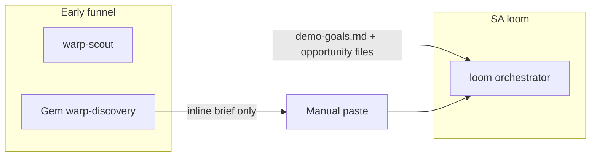
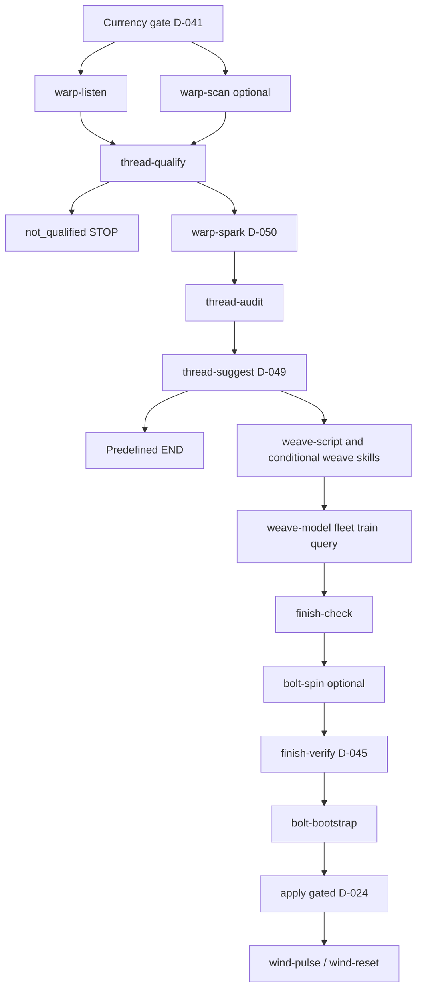
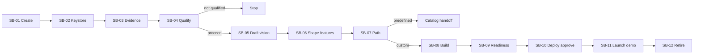
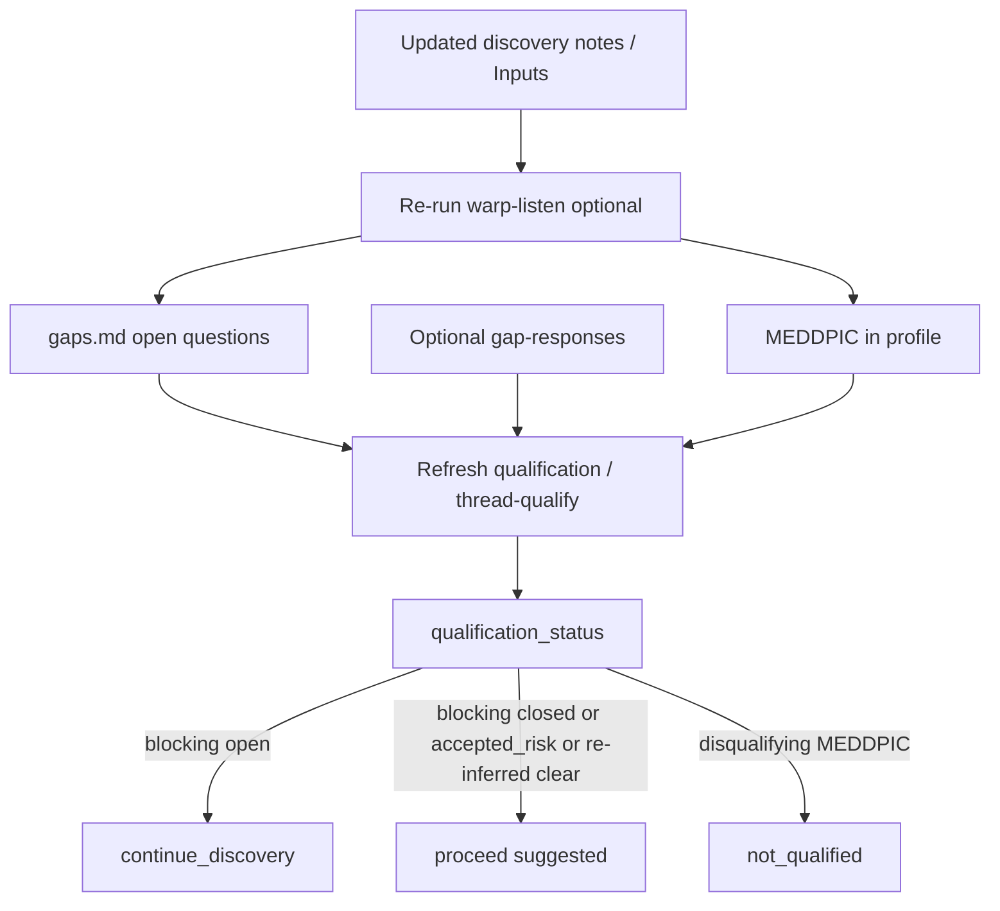

# Loom UX Blueprint

**Status:** Design artifact (not an implementation)  
**Audience:** Solutions Architects (primary), AE/SDR handoff, product and security reviewers  
**Last updated:** 2026-10-30  

This blueprint turns Loom’s file-and-chat pipeline into a guided **opportunity → vision → demo** journey. It teaches the UX process for readers new to journey design, maps the current system, proposes a simplified future experience, and defines the security, privacy, and QA rigor needed to pass infosec and QA review.

**Clickable prototype (P1):** [`sa-first-journey-prototype.html`](sa-first-journey-prototype.html) — ten screens for the SA-first journey. Spec and copy live in [Section 7](#7-low-fidelity-storyboards-proposed).

> **Existing vs proposed.** Sections marked **[Existing]** reflect Loom behavior today. Sections marked **[Proposed]** are product controls not yet implemented. Do not treat proposed UI as shipped capability.

---

## 1. UX process primer

If you are new to UX journey design, use this sequence. Each step produces a concrete artifact you can review with stakeholders.

| Step | What it is | What you produce | Loom example |
|------|------------|------------------|--------------|
| **1. Research synthesis** | Gather evidence about users, tasks, and friction from docs, interviews, and observed workflows | Findings list + pain ranking | README / skill handoffs show one-stage-per-chat, Gem → SA paste gap, approval gates |
| **2. Personas** | Named user archetypes with goals, fears, and constraints | 2–4 persona cards | SA (primary), AE/SDR, demo-day SE, infosec reviewer |
| **3. Jobs-to-be-done** | Outcome-oriented statements: “When… I want… so I can…” | JTBD list | “When I leave a discovery call, I want a viability signal so I know whether to invest in a custom demo.” |
| **4. Journey mapping** | Chronological phases of the user’s work, including emotions and handoffs | Current-state + future-state maps | Intake → Qualify → Design → Build & Validate → Present & Retire |
| **5. Information architecture (IA)** | How content and actions are grouped in the product | Sitemap / nav model | Engagement home with Overview, Inputs, Opportunity, Vision, Build, Readiness, Demo, Governance |
| **6. Storyboarding** | Low-fidelity screens that show the story beat by beat | Frame sequences | Create engagement → approve vision → deploy review → open Kibana space |
| **7. Interaction design** | Rules for states, errors, progressive disclosure, and AI trust | Interaction principles | Draft / Generated / Verified / Deployed; evidence-linked AI claims |
| **8. Prototyping** | Clickable or paper models before code | Prototype + test script | Figma / HTML prototype of Engagement Home |
| **9. Usability testing** | Watch real users attempt tasks; note failures | Findings + severity | “Can an SA complete qualify → vision approval without reading skill docs?” |
| **10. Design validation** | Confirm the design meets success measures and review gates | Acceptance criteria + review pack | Infosec evidence pack + QA traceability matrix |

**How to use this blueprint.** Treat Sections 2–3 as research synthesis and journey maps. Treat Sections 4–6 as IA and storyboards. Treat Sections 7–8 as the rigor that infosec/QA will ask for. Treat Section 9 as the validation roadmap.

---

## 2. Personas and jobs-to-be-done

### Personas

| Persona | Primary goal | Success looks like | Primary fear |
|---------|--------------|--------------------|--------------|
| **Solutions Architect (SA)** — primary | Turn discovery into a credible Elastic demo without hand-authoring assets | Opportunity scored, vision approved, cluster ready, Kibana space deep-linked | Customer data leak; broken demo; surprise cloud spend |
| **AE / SDR** | Capture discovery and hand off a viable opportunity | Structured intake package the SA can open without re-asking questions | Over-promising; incomplete handoff |
| **Demo-day SE / SA** | Present confidently | Checklist green, pulse healthy, script + Kibana path clear | Stale data, missing space, broken panels |
| **Infosec / QA reviewer** | Approve the product path | Traceable approvals, least privilege, retention, test evidence | Unaudited LLM handling of customer notes; broad API keys |

### Jobs-to-be-done

1. When I collect customer interaction notes, I want a structured opportunity assessment so I know whether to invest in a custom demo.
2. When the opportunity is viable, I want a vision of an Elastic-capability demo so stakeholders share the same story before build.
3. When the vision is approved, I want story, data, and assets generated from that vision so the demo is consistent and deployable.
4. When deploy is requested, I want gated review and dry-run so spend and mutation never happen by accident.
5. When the deal closes or the demo ends, I want guided teardown and retention so customer artifacts do not linger.

---

## 3. Current-state journey **[Existing]**

### Source of truth vs drift

| Source | Role |
|--------|------|
| [`skills/loom/SKILL.md`](../../skills/loom/SKILL.md) | **Authoritative** stage order, gates, session handoffs |
| [`docs/pipeline.md`](../pipeline.md) | Useful layout; **lags** orchestrator (omits `thread-suggest`, `weave-fleet`, ideation gate D-050) |
| [`docs/runtimes/cursor.md`](../runtimes/cursor.md) | Session-per-stage; attach files, not chat history |
| [`AGENTS.md`](../../AGENTS.md) | Engagement hygiene, D-024 deploy approval, privacy rules |
| Stage `SKILL.md` files | Per-stage I/O contracts |

### Actors and entry points



| Actor | Tool | Ends at |
|-------|------|---------|
| SDR / AE | Gemini Gem (`warp-discovery`) | Chat-only outputs; **no** engagement folder write |
| AE / SDR (technical) | `warp-scout` | `opportunity/{slug}-demo-goals.md` |
| SA | `loom` | Full planning + optional deploy |

### Logical dependency journey

Prefer **dependency order** over numbered stages (ideation Mode 1 needs `demo-goals.md` from qualification, which needs discovery JSON).



### Artifact layout **[Existing]**

```
$LOOM_ENGAGEMENTS_ROOT/{slug}/     # default ~/engagements/{slug}
├── .env / .env.example            # credentials — never in git
├── {slug}-pipeline-state.json     # stage inventory + input_hash
├── opportunity/                   # AE/SDR/SA alignment
├── demo/                          # SA design intelligence
├── data/                          # model, ML, mappings
└── deploy/                        # checklist, risks, asset-bundle, tf, bootstrap
```

### Gates that stop or branch **[Existing]**

| Gate | Decision | Effect |
|------|----------|--------|
| Reference currency | D-041 | Block if loom clone stale |
| Qualification | `thread-qualify` | `not_qualified` → stop; team alignment before audit |
| Ideation + confirmation | D-050 | No platform audit until SA freezes vision |
| Predefined vs custom | D-049 | Predefined → end custom build path |
| Schema / field population | D-043, D-044 | No asset authoring without confirmed schema; null viz fields = no-go |
| Verify before bootstrap | D-045 | No Terraform/Python gen without `asset-bundle/` |
| Live deploy | D-024 | Explicit SA review of tf, bootstrap, audit, risks, checklist |

### UX pain points (current)

1. **Cognitive load** — Stages 0–9 with conditionals; skill names exposed to humans.
2. **Session model tension** — README “one session” vs Cursor “one stage per chat.”
3. **Gem → SA gap** — Inline-only outputs; SA must recreate engagement manually.
4. **Doc drift** — `pipeline.md` / efficiency tables omit stages; ideation order ambiguous.
5. **Approvals are conversational** — No durable who/when/artifact-hash record for infosec.
6. **`finish-check` vs `finish-verify`** — Bundle checks appear before bundle exists unless SA re-runs check after verify.
7. **Broad automation keys** — Documented bootstrap profile is powerful; no engagement-scoped key UX.
8. **No unified engagement portal** — Handoffs are files + env vars.

---

## 4. Product direction **[Proposed]**

| Layer | Choice | Rationale |
|-------|--------|-----------|
| **Control plane** | Lightweight custom internal app (or Cursor-adjacent shell) | Orchestrates local artifacts, agents, approvals, and pipeline state. A Kibana space alone cannot safely own local `.env`, pre-cluster work, or SA approvals without a custom Kibana plugin and its release/security burden. |
| **Demo destination** | Per-engagement Kibana space `/s/{slug}` | Native Elastic UX; aligns with Terraform space creation, tagging, and manifest teardown. |
| **Optional branch** | Custom demo app (e.g. Vulcan → demo-starter) | Branding only; never replace Kibana as deploy truth. |
| **Early funnel** | Gem today; Slack IT-gated later | Discovery only; no deploy buttons; structured intake package for SA. |

**Preserve Loom contracts:** `$LOOM_ENGAGEMENTS_ROOT/{slug}/`, `{slug}-pipeline-state.json`, JSON stage handoffs, resumability, D-024 / D-045 gates.

---

## 5. Simplified future journey **[Proposed]**

Five **user-facing** phases. Internal skill names stay in an expert Activity Log.

| Phase | User intent | Behind the scenes (skills) | Exit criteria |
|-------|-------------|----------------------------|---------------|
| **1. Intake** | Create or import engagement; set per-engagement keystore; attach notes / diagnostics | Currency gate; engagement `.env`; `warp-listen`; optional `warp-scan`; import Gem/scout package | Keystore path ready (values optional until live stages); evidence extracted; gaps listed |
| **2. Qualify** | Decide opportunity viability with AE/SDR | `thread-qualify` | Status `proceed` \| `continue_discovery` \| `not_qualified`; team alignment recorded |
| **3. Design** | Paint the Elastic demo vision; shape which Elastic capabilities carry the story; choose build path | `warp-spark`; `thread-audit`; `thread-suggest` | Ideation frozen with capability map (incl. SA-requested features); confirmation approved; predefined **or** custom committed |
| **4. Build & Validate** | Generate story, data, assets; prove readiness | `weave-*`; `finish-check`; optional `bolt-spin`; `finish-verify` | Checklist + verify green; asset-bundle present for custom path |
| **5. Present & Retire** | Deploy (gated), present, tear down | `bolt-bootstrap`; D-024 apply; `wind-pulse`; `wind-reset` | Demo live in Kibana space; later retention/teardown complete |

### Dependency-based UX (not numbered stages)

The UI advances when **required inputs exist**, not when a stage number completes:

- Vision (ideation) unlocks after qualification produces `demo-goals` **or** discovery context is enough for Mode 2/3.
- Build unlocks only after custom path is chosen.
- Live-cluster verify unlocks only after `.env` / provision.
- Deploy apply unlocks only after verify + dry-run + signed approval.

### Predefined path

If Design chooses **predefined**, end Build: show recommendation, link to standard demo catalog, skip custom weave/bootstrap. Mark engagement `path: predefined` in pipeline state.

---

## 6. Information architecture **[Proposed]**

### Engagement Home navigation

```
Engagement Home / {slug}
├── Overview          Status, next action, blockers, deep links
├── Inputs            Raw notes, diagnostics, upload, evidence links, **engagement keystore** (`.env`)
├── Opportunity       Qualification, MEDDPIC, summary, demo-goals
├── Demo Vision       Ideation, capability map, SA feature adds, confirmation, path choice
├── Build             Script, data model, integrations, ML, agents
├── Readiness         Pre-cluster + live-cluster checks (unified)
├── Demo              Kibana space deep links, brief, pulse
└── Governance        Approvals, audit log, retention, secrets posture
```

### Role boundaries

| View | AE/SDR | SA | Infosec |
|------|--------|----|---------|
| Inputs / Opportunity | Write / review (no secret values) | Own (incl. keystore) | Read keystore **status** only |
| Demo Vision / Build | Read | Write / approve | — |
| Readiness / Demo | — | Own | Read evidence |
| Governance | — | Own | Primary reviewer |

### Canonical artifact ownership (maps to folders)

| Nav area | Primary folder | Examples |
|----------|----------------|----------|
| Inputs | engagement root + `demo/` + raw uploads | `.env` / `.env.example` (keystore), `discovery.json`, `current-state.json` |
| Opportunity | `opportunity/` | summary, profile, confirmation, gaps, **gap-responses** *[Proposed]*, demo-goals |
| Demo Vision | `demo/` | `ideation.md` (capability map + out of scope), confirmation refresh |
| Build | `demo/` + `data/` | script, agent spec, mappings, fleet manifest |
| Readiness | `deploy/` | checklist, risks, `asset-bundle/` |
| Demo | cluster + `deploy/` | space URL, brief, pulse report |
| Governance | root + logs | `pipeline-state.json`, approval records, provision/teardown logs |

---

## 7. Low-fidelity storyboards **[Proposed]**

**Clickable prototype:** open [`sa-first-journey-prototype.html`](sa-first-journey-prototype.html) in a browser (Left/Right arrows or phase pills). Illustrative Acme Corp engagement — not product UI. Intake includes **engagement keystore** (SB-02); Design includes **capability map + SA feature adds** (SB-06).

### 7.1 Storyboard flow



| Beat | Phase | Nav focus | SA does | System does | Gate / branch |
|------|-------|-----------|---------|-------------|---------------|
| SB-01 | Intake | Inputs | Create engagement: **sales identity** + **public `acme-…` slug** | Create folder/`pipeline-state` under public slug; store company/opp privately | Never put customer name on shared demo assets |
| SB-02 | Intake | Inputs | Define keystore: manual, sample, or **clone from sibling engagement** picklist | Write `{slug}/.env`; list other root `.env`s; copy values (optional keys) | Keep this slug’s space path; no shared file link; never log secrets |
| SB-03 | Intake | Inputs | Correct claims and gaps | Evidence linked to source spans | Continue only after review |
| SB-04 | Qualify | Opportunity | Review MEDDPIC/gaps; **direct Inputs edits** and/or optional responses; refresh; record viability | Re-parse notes and/or apply responses; update profile status | Blocking gaps open → continue_discovery; `not_qualified` → stop |
| SB-05 | Design | Demo Vision | Draft storyline + confirmation preview | Propose archetype-aligned vision | Continue to capability map |
| SB-06 | Design | Demo Vision | Review leveraged features; add/request features; freeze map | Write capability map + out-of-scope into ideation | D-050 freeze includes features |
| SB-07 | Design | Demo Vision | Choose predefined vs custom | Audit **selected** features; catalog match | Predefined ends build |
| SB-08 | Build & Validate | Build | Watch / pause generation | Weave selected features into script/data/assets | Activity log shows skills |
| SB-09 | Build & Validate | Readiness | Run pre-cluster / live verify | Checklist + schema / ES\|QL probes | Live lane needs keystore |
| SB-10 | Present & Retire | Governance | Review artifacts; approve apply | Dry-run; hash approval record | D-024 signed approval |
| SB-11 | Present & Retire | Demo | Choose launch surface + open live script | Kibana / custom UX / agent runtime; script + brief | Demo destination ≠ control plane |
| SB-12 | Present & Retire | Governance | Retire with retention note | Dry-run / teardown / local delete | Typed slug confirm |

### 7.2 Navigation copy (Engagement Home)

Use this chrome consistently across frames. Phase pills are the journey; left nav is location.

| Control | Label | Purpose |
|---------|-------|---------|
| Phase pill 1 | Intake | Create/import + evidence |
| Phase pill 2 | Qualify | Viability decision |
| Phase pill 3 | Design | Vision draft + capability map + build path |
| Phase pill 4 | Build & Validate | Generate + readiness |
| Phase pill 5 | Present & Retire | Deploy, demo, teardown |
| Nav | Overview | Status, next action, blockers |
| Nav | Inputs | Raw notes, diagnostics, evidence, engagement keystore |
| Nav | Opportunity | Qualification, summary, demo-goals |
| Nav | Demo Vision | Ideation, capability map, SA feature adds, confirmation, path choice |
| Nav | Build | Script, data, integrations, agents |
| Nav | Readiness | Pre-cluster + live-cluster checks |
| Nav | Demo | Launch surfaces (Kibana / custom UX / agent runtime), live script, brief, pulse |
| Nav | Governance | Approvals, audit log, retention, secrets |

**Chrome title pattern:** `Loom control plane · {Company}`  
**Phase subtitle pattern:** `{Phase} · {Screen job}` (e.g. `Design · Freeze vision`)

### 7.3 Screen frames

Frames are intentionally sparse — one job per frame. Primary CTA is bolded in the wire.

#### SB-01 Create or import engagement

**Nav:** Inputs · **Primary CTA:** Create

```
┌─────────────────────────────────────────────┐
│  New engagement                             │
│  Sales identity (private)                   │
│  Company: [Northwind Pharmaceuticals____]   │
│  Opportunity: [NW Pharma — SOC AI FY26__]   │
│  Opportunity ID: [006… optional SFDC____]   │
│  Public demo identity (shared assets)       │
│  Demo slug: [acme-pharma____________]       │
│  Display:   [Acme Pharma____________]       │
│  hints: acme-pharma · acme-insfraud · …     │
│  ○ Import AE/SDR package  ○ Start from notes│
│  ⚠ Customer name never on shared demo assets│
└─────────────────────────────────────────────┘
```

**Dual identity (required):**

| Layer | Fields | Used for | Must NOT appear on |
|-------|--------|----------|-------------------|
| **Sales / private** | Company name, opportunity name, optional SFDC ID | Opportunity docs, AE handoffs, control-plane chrome, sales traceability | Kibana space name, dashboard titles, seed data, Agent Builder public copy, `loom:` tags, index names on shared clusters |
| **Public demo** | `DEMO_SLUG` = `acme-{industry\|usecase}`, display name e.g. Acme Pharma | Folder under engagements root, `KIBANA_SPACE_PATH=/s/{slug}`, tags, bootstrap assets, live script customer-facing wording | — |

Slug pattern examples: `acme-pharma`, `acme-insfraud`, `acme-retailsearch`, `acme-observability`. Folder and pipeline files use the **public** slug; map private names in engagement metadata / `.env` (`ENGAGEMENT` or proposed `COMPANY_NAME` + `OPPORTUNITY_NAME`).

**Copy notes:** Import path expects `demo-goals.md` + discovery files. Warn before create if root is cloud-synced. Next screen is the engagement keystore.

#### SB-02 Engagement keystore

**Nav:** Inputs · **Primary CTA:** Save keystore / Continue

Each engagement has an **isolated** keystore at `{engagement_dir}/.env` (see [`skills/references/env-reference.md`](../../skills/references/env-reference.md)). Not shared across engagements; never committed to git.

```
┌─────────────────────────────────────────────┐
│  Inputs · Keystore                          │
│  Path: ~/engagements/acme-2026/.env         │
│  Populate:                                  │
│  ● Enter manually                           │
│  ○ Load from sample (.env.example)          │
│  ○ Clone from another engagement            │
│      Picklist: [2026CitizensAI ▾]           │
│      [x] Include API keys and tokens        │
│      [Clone into this engagement]           │
│  Endpoints / credentials (editable form)    │
│  [Save keystore] [Continue]                 │
└─────────────────────────────────────────────┘
```

**Clone-from-engagement behavior:**

1. Scan `$LOOM_ENGAGEMENTS_ROOT` (default `~/engagements`) for sibling folders that contain a `.env` (or readable keystore).
2. Picklist shows **slug + presence summary** (e.g. “ES+Kibana set” / “partial”) — not secret values.
3. **Clone copies into this engagement’s `.env`** — it does not keep a live link to the source file; each slug stays isolated after clone.
4. Default: keep **this** engagement’s `DEMO_SLUG` / `KIBANA_SPACE_PATH` (do not overwrite with the source slug’s space).
5. Optional checkbox: **Include API keys and tokens** (on by default for same-cluster reuse; off = URLs / endpoints only).
6. After clone, SA reviews and **Save keystore** before Continue.

**Rules:**

1. One keystore **file per engagement** — clone duplicates values; never point two slugs at the same `.env` path.
2. UI shows **set / missing / expired**, not secret values in activity logs or toasts.
3. Planning (Qualify / Design / Build authoring) can proceed with empty cluster creds; **Readiness live verify**, **Deploy**, and **agent-runtime launch** require URLs + keys.
4. Separate `ES_API_KEY` and `KIBANA_API_KEY` (D-016).
5. If engagement root syncs to Drive/OneDrive, prefer `.env` on a **local symlink**.
6. Optional fields (EC, Fleet, OTLP) appear when deployment type needs them.
7. Picklist is scoped to the **configured engagements root** only (no browsing outside that tree).

#### SB-03 Review extracted evidence

**Nav:** Inputs · **Primary CTA:** Continue

```
┌─────────────────────────────────────────────┐
│  Inputs · Evidence                          │
│  Claims          Source excerpt             │
│  “Need AI SIEM”  notes.md:¶12  [open]       │
│  Gap: Economic buyer unnamed                │
│  [Edit claim] [Mark resolved] [Continue]    │
└─────────────────────────────────────────────┘
```

**Copy notes:** Claims are editable. Gaps stay visible until resolved or explicitly accepted.

#### SB-04 Qualification decision

**Nav:** Opportunity · **Primary CTA:** Record decision

```
┌─────────────────────────────────────────────┐
│  Opportunity · Viability                    │
│  Optional: [Review MEDDPIC] [Review AE gaps]│
│            [Open summary] [Open demo goals] │
│  Gaps inbox (responses editable here)       │
│  · Economic buyer … [response] [Answered]   │
│  Qualify readiness: 1 blocking gap open …   │
│  [Refresh qualification]                    │
│  Status: ○ Proceed  ○ Continue discovery    │
│          ○ Not qualified                    │
│  [Record decision]                          │
└─────────────────────────────────────────────┘
```

**Copy notes:** “Not qualified” archives and ends custom build. “Continue discovery” parks until gaps are answered or accepted as risk.

### Where AE/SA edit gaps — and how Loom updates Qualify readiness **[Proposed]**

Today Loom writes gaps in `opportunity/{slug}-gaps.md` (`warp-listen`) and MEDDPIC in `opportunity-summary.md` + `opportunity-profile.json` (`thread-qualify`). There is **no first-class “gap response” object** yet — re-runs of `thread-qualify` after new notes are the usual path.

**Recommended product model:**

| Artifact | Role | Who edits |
|----------|------|-----------|
| `opportunity/{slug}-gaps.md` | Canonical **open-question list** (field, question, impact, how to get answer) | Pipeline regenerates after listen; may point humans at Inputs |
| Discovery notes / Inputs uploads | **Source of truth** for evidence | **Valid gap-closure path:** SA/AE edit or append what the gap asks for, then re-parse |
| `opportunity/{slug}-gap-responses.json` **[Proposed, optional]** | Lightweight AE/SA answers without rewriting notes | Opportunity Gaps inbox — optional accelerator |
| `opportunity/{slug}-opportunity-profile.json` | Machine MEDDPIC + `qualification_status` | **Refresh qualification** / `thread-qualify` |
| `opportunity/{slug}-opportunity-summary.md` | Human MEDDPIC table + technical questions | Optional rich edit; mirrored from profile |

**Two valid ways to close a gap** (neither is mandatory alone):

| Path | When to use | What happens |
|------|-------------|--------------|
| **A. Update discovery notes / Inputs** | Answer belongs in the source record (call notes, AE email paste, diagnostic). Prefer this when Loom should **re-infer** evidence, MEDDPIC, and gaps from truth. | Opportunity directs SA/AE to the specific Input (file + question). They edit/add notes → re-run `warp-listen` (and qualify) → gaps/MEDDPIC refresh from source. **No new artifact type required.** |
| **B. Structured response on Opportunity** | Quick AE reply, “accepted risk,” or answer that should not rewrite the customer-facing notes trail. | Optional `gap-responses.json` (or inbox fields) → **Refresh qualification** without a full re-parse. |

Directing people **what to update in discovery notes or original Inputs** is a first-class course of action — often better than inventing parallel workflows or mandatory new artifacts. Structured responses are an accelerator, not a replacement for source-of-truth notes.

**How Loom checks readiness on Qualify:**



1. From a gap, offer **Update in Inputs** (deep-link to the note / field to edit) and/or **Record response here**.
2. After Inputs edits: re-run listen → qualify (or **Refresh qualification** if only optional responses changed).
3. **Blocking** gaps still `open` → suggest `continue_discovery`.
4. Gaps closed via re-inference, `answered`, or `accepted_risk` → `proceed` may be suggested; SA still confirms.
5. Disqualifying MEDDPIC → `not_qualified`.
6. Write `qualification_status` + rationale; pipeline-state completes qualify only after **Record decision**.

**AE collaboration:** Share which Input to update *or* the gaps inbox; SA refreshes qualify when source or responses change.

#### SB-05 Draft demo vision

**Nav:** Demo Vision · **Primary CTA:** Shape features

```
┌─────────────────────────────────────────────┐
│  Demo Vision · Draft                        │
│  Storyline: [ideation preview]              │
│  Customer confirmation (preview)            │
│  Next: shape which Elastic capabilities     │
│        carry this story                     │
│                    [Shape features]         │
└─────────────────────────────────────────────┘
```

**Copy notes:** Confirmation stays customer-safe (no “predefined,” “bootstrap,” or internal sales terms). Do not freeze until the capability map is confirmed on SB-05.

#### SB-06 Shape Elastic capabilities

**Nav:** Demo Vision · **Primary CTA:** Approve features

Aligns with `warp-spark` **Elastic Capability Map** (outcome, proof point) and **Out of Scope**.

```
┌─────────────────────────────────────────────┐
│  Demo Vision · Capability map               │
│  In storyline                               │
│  [x] Detection rules — why / proof          │
│  [x] Cases — why / proof                    │
│  [x] AI Assistant — why / proof             │
│  [x] ES|QL — why / proof                    │
│                                             │
│  Add features to the storyline              │
│  [Agent Builder] [Workflows] [ML] …         │
│  Custom: [________________] [Add]           │
│                                             │
│  Out of scope: Custom search UI (excluded)  │
│  [x] Freeze vision + capability map         │
│                    [Approve features]       │
└─────────────────────────────────────────────┘
```

**Interaction rules for this screen:**

1. **From vision** — system proposes 2–4 capabilities tied to pain/audience (not a generic feature dump).
2. **Each row shows** capability name + one-line outcome/proof (“why it is in the story”).
3. **SA can uncheck** to move a capability out of scope.
4. **SA can add** from a curated Elastic catalog (Agent Builder, Workflows, ML, Attack Discovery, Fleet, EIS, SLOs, etc.) or type a **custom feature request**.
5. **SA-added / SA-requested** chips distinguish human intent from model proposals.
6. Freeze writes the map into `demo/{slug}-ideation.md` (capability table + out of scope) before audit.

#### SB-07 Predefined vs custom (audited against map)

**Nav:** Demo Vision · **Primary CTA:** Commit path

```
┌─────────────────────────────────────────────┐
│  Design · Build path                        │
│  Audit · selected features                  │
│  Detection rules …… ready                   │
│  Cases ……………… ready                   │
│  AI Assistant ……… ready                   │
│  ES|QL ……………… ready                   │
│  Agent Builder+tools … amber ▸ expand       │
│    ├ Pipeline-owned: weave-agent/bootstrap  │
│    ├ Manual once: tech-preview / connector  │
│    └ Need evidence: Inputs → re-audit       │
│  ○ Use standard demo (if catalog covers map)│
│  ○ Build custom Elastic demo                │
│                    [Commit path]            │
└─────────────────────────────────────────────┘
```

**What amber means (corrected from prior Loom engagements):**

Prior demos (`2026PurposeAgents`, `2026CitizensAI`, `2026lenovoGAIaaS`) treated most “setup / amber” rows as **work the pipeline still owns** — agent specs, tools, workflows, dashboards, seed data authored via `weave-agent` / bootstrap from discovery — **not** as “expand discovery and restart,” and **not** as SA hand-building agents after the demo as a separate pre-execution step.

| Amber subtype | Meaning | UX action |
|---------------|---------|-----------|
| **Pipeline-owned** (default for agents/tools/workflows/data/dashboards) | Platform can run it; Loom has not authored the asset yet | **Accept into Build** — continue; no discovery restart |
| **Manual once** | Rare non-automatable click (space tech-preview, LLM connector pick) | Surface later on **Readiness** checklist; do not block Design |
| **Unverified / need evidence** | Missing version, license, or diagnostic | Optional deep-link to **Inputs** → re-audit only |
| **Red / blocked** (not amber) | Wrong license, version, or infra | Descope, alternative, or timeline change |

**Copy notes:** Audit rows are the **selected** capability map. Do not send SAs back through discovery because Agent Builder is amber. Predefined only if a catalog demo covers the map; otherwise custom unlocks Build.

#### SB-08 Build progress

**Nav:** Build · **Primary CTA:** Open readiness (when generation allows)

```
┌─────────────────────────────────────────────┐
│  Build                                      │
│  ✓ Story script                             │
│  … Data model                               │
│  ○ Fleet integrations                       │
│  ○ Agent Builder (if in script)             │
│  Activity log ▸ weave-model · running       │
│  [Pause] [Resume from last good]            │
└─────────────────────────────────────────────┘
```

**Copy notes:** Default labels are outcome-oriented. Skill names appear only in Activity log. Build must honor the frozen capability map (including SA-requested features).

#### SB-09 Security / readiness review

**Nav:** Readiness · **Primary CTAs:** Run pre-cluster / Run live verify

```
┌─────────────────────────────────────────────┐
│  Readiness                                  │
│  Pre-cluster checklist   14/16 pass         │
│  Live verify (needs .env)  Not started      │
│  Schema probes · ES|QL · field population   │
│  Blockers: [none]                           │
│  [Run pre-cluster] [Run live verify]        │
└─────────────────────────────────────────────┘
```

**Copy notes:** Bundle-dependent checks belong only in the live lane (after provision / `.env`).

#### SB-10 Deploy approval

**Nav:** Governance · **Primary CTA:** Approve apply

```
┌─────────────────────────────────────────────┐
│  Governance · Deploy approval (D-024)       │
│  Reviewed: [x] main.tf  [x] bootstrap       │
│            [x] audit  [x] risks  [x] list   │
│  Dry-run: terraform plan OK · bootstrap OK  │
│  Approver: [you]  Artifact hash: a3f9…      │
│  [Approve apply]  [Reject]                  │
└─────────────────────────────────────────────┘
```

**Copy notes:** Approve writes who / when / artifact hashes. Conversational “yes” alone is not enough.

#### SB-11 Launch the demo

**Nav:** Demo · **Primary CTA:** depends on launch surface (Kibana overview / custom app / Open in Cursor) + always offer **Open live script**

```
┌─────────────────────────────────────────────┐
│  Demo · Launch                              │
│  Pulse: GREEN · /s/acme-2026                │
│  Present in:                                │
│  ● Kibana space (default deep links)        │
│  ○ Custom UX (optional branded app)         │
│  ○ Agent runtime (Cursor / Claude)          │
│      skills · MCP · A2A → cluster           │
│  Script: [Open live script] [Demo brief]    │
└─────────────────────────────────────────────┘
```

**Launch surfaces:**

| Option | When | What opens |
|--------|------|------------|
| **Kibana space** | Default Elastic product demo | `/s/{slug}` dashboards, Agent Builder, Security/Observability |
| **Custom UX** | Optional branded / Vulcan / demo-starter export exists | Custom app URL against same cluster; never replaces deploy truth |
| **Agent runtime** | SA or audience drives the story via assistant | Cursor or Claude with engagement folder + `.env`; cluster via Elastic skills, MCP, or A2A |

**Script links (always available):** `demo/{slug}-live-script.md` (presenter path), `opportunity/{slug}-demo-brief.md`, copy path for chat attach.

**Copy notes:** Control plane stays the hub; launch leaves to Kibana, custom UI, or agent IDE. Script is a first-class launch target so the SA is never hunting the filesystem mid-demo.

#### SB-12 Teardown and retention

**Nav:** Governance · **Primary CTA:** Execute (after typed slug)

```
┌─────────────────────────────────────────────┐
│  Governance · Retire                        │
│  ○ Dry-run teardown  ○ Delete cluster assets│
│  ○ Delete local engagement folder           │
│  Retention note: [required]                 │
│  Confirm slug: [________]                   │
│  [Execute]                                  │
└─────────────────────────────────────────────┘
```

**Copy notes:** Default to dry-run. Require retention note and slug confirmation before destructive options.

---

## 8. Interaction rules **[Proposed]**

1. **Progressive disclosure** — Default UI uses phase language (Intake, Qualify…). Expert Activity Log shows skill names and model tiers.
2. **Evidence-linked AI** — Every extracted claim links to a source span; editable; never invent customer facts (aligns with `warp-discovery` posture).
3. **Editable assumptions** — Gaps and assumptions are first-class objects, not buried prose.
4. **Explicit human approvals** — Qualification, vision + capability-map freeze, build path, spend (`bolt-spin`), live apply (D-024), teardown — each requires intentional action.
4b. **Outcome-first capabilities** — Design shows *why* each Elastic feature is in the story (outcome/proof). SAs may add catalog or custom features; audit and build consume the frozen map, not a silent feature dump.
5. **Resumable stages** — Drive from `{slug}-pipeline-state.json` and `input_hash`; stale upstream → clear “re-run required” banner.
6. **Error recovery** — Failures cite stage, artifact, and next action; never wipe later artifacts without confirmation.
7. **Non-destructive defaults** — Prefer dry-run, plan, and soft skips; destructive actions need typed confirmation (existing `wind-reset` pattern).
8. **State vocabulary** — Use one of: `Draft` → `Generated` → `Verified` → `Deployed` → `Retired`. Never mix “done” with “deployed.”
9. **Unified readiness** — One Readiness view with two lanes: pre-cluster (`finish-check`) and live-cluster (`finish-verify`). Bundle-dependent checks only appear in the live lane.
10. **Secrets never in chat chrome** — Per-engagement keystore on Inputs maps to `.env`; UI shows “key present / missing / expired,” not values. Never reuse another engagement’s keystore.
11. **Dual identity** — Real company/opportunity for sales traceability; public `acme-{industry|usecase}` slug for all shared demo assets. Customer identity on shared clusters is a no-go.

---

## 9. Security and privacy by design

### 9.1 Data classification **[Existing + Proposed]**

| Class | Examples | Handling |
|-------|----------|----------|
| **Customer identifying** | Real company/opportunity names, discovery notes, confirmation docs, opportunity summaries | Engagement folder + control plane only; **never** on shared demo assets (use `acme-…` slug) **[Existing + Proposed]** |
| **Credentials** | `ES_API_KEY`, `KIBANA_API_KEY`, `EC_API_KEY` | `.env` at engagement root; never commit; never paste EC key in chat **[Existing]** |
| **Generated demo data** | Seed docs, synthetic events | Prefixed indices; teardown via manifest **[Existing]** |
| **Audit metadata** | Approvals, hashes, deploy logs | Retain per org policy; no secrets in logs **[Proposed]** |

### 9.2 Minimization and redaction **[Proposed]**

- Intake upload offers optional PII redaction before LLM stages.
- Eval fixtures remain illustrative composites only (**[Existing]** in `AGENTS.md`).
- Customer-facing confirmation forbids internal sales jargon and invented content (**[Existing]** discovery posture).

### 9.3 Storage posture **[Existing + Proposed]**

- Default root `~/engagements` outside git **[Existing]**.
- **[Proposed]** UI warns when engagement root is cloud-synced; offer “`.env` stays on local symlink” toggle.
- Manifest index `loom-manifests` persists by design for teardown (**[Existing]** D-039) — document in Governance view.

### 9.4 Identity and RBAC **[Existing + Proposed]**

| Concern | Status |
|---------|--------|
| Separate ES and Kibana API keys (D-016) | **[Existing]** |
| Bootstrap key profile documented (broad) | **[Existing]** |
| Engagement-scoped least-privilege key wizard | **[Proposed]** |
| Demo audience viewer role on Kibana space | **[Proposed]** |
| SA vs automation identity separation | **[Proposed]** |

### 9.5 Approval audit trail **[Proposed]**

Append to `pipeline-state.json` (or sibling `{slug}-approvals.json`):

```json
{
  "action": "deploy_apply",
  "approver": "sa@elastic.co",
  "timestamp": "2026-10-30T18:00:00Z",
  "artifacts": {
    "main.tf": "sha256:…",
    "bootstrap-data.py": "sha256:…",
    "platform-audit.json": "sha256:…",
    "risks.md": "sha256:…",
    "demo-checklist.md": "sha256:…"
  },
  "dry_run_ok": true
}
```

Conversational “yes” alone is **not** sufficient for formal audit evidence.

### 9.6 Encryption and logging **[Proposed]**

- Expect disk encryption for engagement roots (org standard); document requirement in Governance.
- Redact API keys and tokens from activity logs and error exports.
- LLM processing: Gem uses Google Gemini per Workspace policy — surface that disclosure in Intake for AE/SDR path.

### 9.7 Threat model (summary) **[Proposed]**

| Threat | Mitigation |
|--------|------------|
| Accidental commit of `.env` | Pre-commit / UI hygiene; gitignore; staging guards |
| Over-broad automation key abuse | Scoped keys; rotation reminder; space-limited Kibana roles |
| Prompt injection via pasted notes | Treat notes as untrusted input; no auto-execute of embedded instructions |
| Unauthorized cluster spend | D-024 gate + signed approval + dry-run first |
| Residual customer data | Retention wizard + teardown + local folder delete |
| Supply chain | Dependency currency gate (D-041); SBOM / secrets scan in CI for control plane |

### 9.8 Retention **[Existing + Proposed]**

- Delete engagement directories when deal closes or demo torn down (**[Existing]** `AGENTS.md`).
- **[Proposed]** Guided Retire wizard: dry-run → cluster assets → optional project delete → local folder → written retention note.

---

## 10. QA, accessibility, and SDLC rigor

### 10.1 Accessibility **[Proposed]**

- Target **WCAG 2.2 Level AA** for the control plane.
- Prefer Elastic UI (EUI) patterns where practical for consistency with Kibana.
- Keyboard-complete primary flows: Intake → Qualify → Vision approve → Deploy approve.
- Generated Kibana content: follow product defaults; document known Lens/dashboard a11y limits rather than inventing parallel UI.

### 10.2 Testing layers **[Existing + Proposed]**

| Layer | Purpose | Loom today |
|-------|---------|------------|
| Unit | Pure transforms, hash, state machine | Sparse; expand with control plane |
| Contract | JSON schemas in `schemas/` | **[Existing]** |
| Skill evals | Per-skill `evals/evals.json` | Schema/inventory via `run_evals.py` (**[Existing]**); LLM assertion runs **[Proposed]** |
| Integration | Stage chaining on fixtures | Partial |
| E2E dry | Plan + bootstrap `--dry-run` | **[Existing]** allowed without D-024 |
| Live-cluster | finish-verify + bootstrap pair | Flagged incomplete in `docs/todo.md` — required before production UX claim |
| Usability | Task success with SAs | **[Proposed]** |

### 10.3 Fixture and privacy hygiene **[Existing]**

- No real customer names/contacts in repo evals.
- Engagement artifacts stay outside the git repo.

### 10.4 Usability acceptance criteria **[Proposed]**

An SA who has not read skill docs can:

1. Import or create an engagement from notes in &lt; 10 minutes.
2. Reach a recorded qualification decision with evidence visible.
3. Draft a demo vision, shape the Elastic capability map (including an SA-added feature), and understand predefined vs custom.
4. Explain deploy risk from the approval screen before applying.
5. Open the correct Kibana space from Demo without guessing the URL.
6. Complete teardown with a retention note.

### 10.5 Infosec evidence pack **[Proposed]**

Package for review:

1. Data flow diagram (Intake → LLM → engagement FS → cluster).
2. Data classification table (Section 9.1).
3. Secrets handling and key scoping design.
4. Approval audit schema and sample records.
5. Retention / teardown procedure.
6. Threat model summary.
7. Dependency / SBOM and secrets-scan results for the control plane.
8. Accessibility statement (WCAG 2.2 AA target).
9. Test evidence: contract, dry-run, live-pair (when available).
10. Mapping to existing decisions D-016, D-024, D-026, D-039, D-041, D-043–D-045.

### 10.6 Release gates **[Proposed]**

| Gate | Required |
|------|----------|
| Schema + eval inventory green | Yes |
| Dry-run plan/bootstrap on fixture engagement | Yes |
| Live verify+bootstrap on non-prod cluster | Yes before GA |
| Infosec review of evidence pack | Yes before GA |
| Accessibility smoke on primary flows | Yes before GA |
| Rollback / teardown documented and dry-run tested | Yes |

### 10.7 Post-deploy monitoring **[Existing + Proposed]**

- `wind-pulse` as Demo readiness signal **[Existing]**.
- **[Proposed]** Surface pulse + checklist on Demo Overview; alert if space missing or prefix blank on shared cluster.

---

## 11. Phased roadmap and success measures **[Proposed]**

| Phase | Outcome | Exit |
|-------|---------|------|
| **P0 Blueprint validation** | This document reviewed with 2–3 SAs + one security reviewer | Comments resolved; direction accepted |
| **P1 Prototype** | Clickable Engagement Home covering SB-01–SB-10 — [`sa-first-journey-prototype.html`](sa-first-journey-prototype.html) drafted | Usability test: 5 tasks, ≥80% success without coaching |
| **P2 Thin slice** | Intake + Qualify + Vision freeze writing real engagement files + pipeline-state | Parity with `warp-scout` / `warp-spark` outputs |
| **P3 Build & Readiness slice** | Progress UI + unified readiness calling existing skills/CLIs | finish-check / finish-verify statuses visible |
| **P4 Controlled pilot** | Deploy approval records + Kibana deep links on real non-prod demos | Infosec pack complete; live pair validated |
| **P5 Production review** | Retention wizard, scoped keys, a11y AA smoke | Release gates (10.6) all green |

### Success measures

| Measure | Definition | Target (pilot) |
|---------|------------|----------------|
| Time-to-qualified decision | Intake start → recorded qualification | ↓ vs baseline chat-only |
| Handoff completeness | % AE packages that open without SA rework | ≥ 90% |
| Stage rework rate | Re-runs caused by unclear UX vs real input change | Track; reduce UX-caused |
| Approval clarity | % deploys with complete artifact-hash record | 100% |
| Deploy defects | Broken panels / null fields caught pre-demo | Zero escapes after verify green |
| Teardown completion | Engagements with recorded retire within N days of close | ≥ 95% |

---

## 12. Mapping: user phases ↔ Loom skills

| User phase | Skills (hidden by default) | Key decisions |
|------------|----------------------------|---------------|
| Intake | D-041 currency; `warp-listen`; `warp-scan` | — |
| Qualify | `thread-qualify` | Stop if `not_qualified` |
| Design | `warp-spark`; `thread-audit`; `thread-suggest` | D-050; D-049 |
| Build & Validate | `weave-script`, `weave-agent`, `weave-cost`, `weave-query`, `weave-model`, `weave-fleet`, `weave-train`; `finish-check`; `bolt-spin`; `finish-verify` | D-043–D-045 |
| Present & Retire | `bolt-bootstrap`; apply; `wind-pulse`; `wind-reset` | D-024 |

---

## 13. Open design questions

1. Should the control plane be a local web app, a Cursor Canvas/extension, or a thin CLI+TUI first?
2. Who hosts AE/SDR intake long-term (Gem only vs Slack after IT)?
3. Is engagement-scoped API key generation in-product or a documented runbook beside the UI?
4. How much Kibana chrome is acceptable for customer audiences vs SA rehearsal?

Resolve these in P0 review; they do not block blueprint acceptance.

---

## 14. References

- [`sa-first-journey-prototype.html`](sa-first-journey-prototype.html) — P1 clickable storyboard  
- [`AGENTS.md`](../../AGENTS.md) — hygiene, D-024, privacy  
- [`README.md`](../../README.md) — six-phase overview  
- [`skills/loom/SKILL.md`](../../skills/loom/SKILL.md) — orchestrator (source of truth)  
- [`docs/pipeline.md`](../pipeline.md) — workspace layout (note drift)  
- [`docs/decisions.md`](../decisions.md) — D-016, D-024, D-026, D-039, D-041, D-043–D-050  
- [`docs/design-principles.md`](../design-principles.md)  
- [`docs/agent-patterns.md`](../agent-patterns.md) — Tier A/B/C execution  
- [`docs/engagements-path.md`](../engagements-path.md)  
- [`docs/runtimes/cursor.md`](../runtimes/cursor.md) · [`docs/runtimes/gem.md`](../runtimes/gem.md)  
- [`schemas/README.md`](../../schemas/README.md)  
- [`skills/warp-scout/SKILL.md`](../../skills/warp-scout/SKILL.md) · [`skills/warp-discovery/`](../../skills/warp-discovery/)  
- [`skills/references/env-reference.md`](../../skills/references/env-reference.md) · [`loom-tagging.md`](../../skills/references/loom-tagging.md) · [`asset-manifest.md`](../../skills/references/asset-manifest.md)
