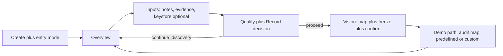

# P2/P3 prototype validation

**Status:** Validated 2026-10-30 — direction accepted; contracts need the patches below before Full P2  
**Scope:** [`loom-ux-blueprint.md`](loom-ux-blueprint.md), [`sa-first-journey-prototype.html`](sa-first-journey-prototype.html), [`p2-handoff.md`](p2-handoff.md) vs loom skills, schemas, and decisions  
**Verdict:** The SA-first direction holds. Full P2 is **not yet buildable as written** — about fourteen contract gaps block a clean implementer handoff. P3 needs one readiness change and one missing beat.

Severity: **Blocker** (P2 cannot ship correctly) · **High** (wrong behavior or adoption friction) · **Medium** (docs/prototype polish) · **Low** (nice-to-have)

Owner: **UX** = this lineage (blueprint / prototype / handoff) · **P2** = implementation chat · **P3** = later slice

---

## A. P2 contract gaps

| ID | Finding | Severity | Owner |
|----|---------|----------|-------|
| A1 | Slug still derived from company name in `loom` Step 1, `warp-listen`, `warp-scout`, `warp-scan`; `ENGAGEMENT` = real company in `env-reference.md`. Conflicts with SB-01 dual identity. | Blocker | P2 |
| A2 | Private identity must not live in `.env` (clone would leak customer names). Keep in `pipeline-state` / engagement metadata; Acme vs real-name per-artifact table. | Blocker | UX + P2 |
| A3 | Slug uniqueness: D-026 normalizes `acme-pharma` → `loom:acmepharma` (manifest doc ID). Collision on shared cluster = teardown risk. Prototype showed hyphenated tag incorrectly. | Blocker | UX + P2 |
| A4 | Keystore clone omits `INDEX_PREFIX`, `KIBANA_SOLUTION`, and skip rules for `DEMO_ASSET_TAG` / `CLUSTER_NAME` / `DEPLOYMENT_ID`. | High | UX + P2 |
| A5 | Stub `.env` from SB-02 looks like `cloud-provision` complete (`inventory.py`). Need separate keystore status + optional version probe. | High | UX + P2 |
| A6 | No canonical `inputs/` folder for Path A (edit notes → re-listen). Orchestrator assumes `discovery/` informally. | High | UX + P2 |
| A7 | Evidence spans / stable `gap_id` missing from `warp-listen`. Need `source_ref`, `discovery.schema.json`, `gap-responses.schema.json`. | Blocker | P2 |
| A8 | `accepted_risk` missing from `opportunity-profile.schema.json`; need `qualification_decision` object; AE alignment is passive in prototype. | High | P2 + UX |
| A9 | `thread-audit` ignores frozen ideation capability map; no `remediation_owner` for amber subtypes. | Blocker | P2 |
| A10 | Handoff §3 missing audit + predefined-recommendation artifacts; no `stages.build-path` / top-level `path` reconciliation. | High | UX |
| A11 | “Build Path” overloaded (warp-spark Quick/Customized vs predefined/custom). Rename UX to **Demo path**. | Medium | UX |
| A12 | Vision screens omit archetype, wow moments, data strategy, min bar, D-036; Agent Builder → weave-cost; 2–4 capability warning. | High | UX |
| A13 | Confirmation approval after freeze (D-050) not recorded; opportunity-summary TL;DR refresh not in handoff. | High | UX + P2 |
| A14 | Orchestrator Step 0b / Stage 0 put spark before listen; UX correctly uses listen → qualify → spark (Mode 1). Align orchestrator to dependency order. | Blocker | P2 |

---

## B. P3 gaps (Build & Readiness)

| ID | Finding | Severity | Owner |
|----|---------|----------|-------|
| B1 | `finish-check` C-1–C-5 always fail pre-cluster (need `asset-bundle/`). Add `--lane pre-cluster`. | Blocker | P3 |
| B2 | Missing SB-09b Cluster target + generate deploy artifacts (`bolt-spin` spend gate, `finish-verify`, `bolt-bootstrap` plan/dry-run). | Blocker | UX + P3 |
| B3 | Build-time human gates (`weave-fleet` storyline_enhancement; `weave-query` uses `../vulcan/.env`). Need “decision needed” + engagement keystore only. | High | P3 |
| B4 | Build progress list should derive from frozen capability map (“why included”). | Medium | UX + P3 |

---

## C. Prototype / blueprint defects

| ID | Finding | Severity | Owner |
|----|---------|----------|-------|
| C1 | `sr-only` says “ten screens”; HTML comments mislabeled (SB-04/05/…). | Low | UX |
| C2 | Overview nav jumps to Create — no Overview frame; blocks resume / “what’s next”. | High | UX |
| C3 | Import AE/SDR package default still walks listen evidence. | Medium | UX |
| C4 | Record decision with continue_discovery advances to Design; should park on Overview. | High | UX |
| C5 | Blueprint: “confirmed on SB-05” → SB-06; `acme-2026` vs `acme-pharma` inconsistency. | Medium | UX |
| C6 | Real engagement slugs in blueprint/prototype (hygiene / engagement-agnostic). | High | UX |

---

## D. Streamlining (flexibility + fast adoption)

| ID | Change | Severity | Owner |
|----|--------|----------|-------|
| D1 | Merge SB-05 + SB-06 into one Vision screen (freeze + confirmation review). | High | UX |
| D2 | Keystore deferrable until live lane. | Medium | UX |
| D3 | Branch by entry mode (import / notes / scratch → warp-spark Mode 1/2/3). | Medium | UX |
| D4 | Overview as hub: computed next action + blockers. | High | UX |
| D5 | Library + CLI (`loom_state`: new, keys, listen, qualify decide, vision freeze, path, next). | Blocker | P2 |
| D6 | Derive phase from `stages` (do not store `ux.phase` as source of truth). | High | UX + P2 |
| D7 | Single `approvals[]` log (blueprint §9.5 shape) for all gates through D-024. | High | UX + P2 |
| D8 | Content-hash `input_hash` (sha256); stage status `stale` / `blocked`. | Medium | P2 |
| D9 | Shared `capability-catalog.md` for map chips, audit rows, build list. | Medium | P2 |
| D10 | Schemas: `pipeline-state`, `gap-responses`, `discovery` + eval wiring. | High | P2 |

---

## Recommended sequence

1. **UX chat (this pass):** Apply patches to handoff, blueprint, prototype; remove real slugs; land this report.  
2. **P2 implementation chat:** Bootstrap + state library first; then skill/schema work packages A1, A7–A10, A14; fixtures under temp `LOOM_ENGAGEMENTS_ROOT`.  
3. **P3:** B1–B4 after P2 exit criteria green.

Direction (five phases, dual identity, isolated keystore, dual gap closure, amber = pipeline-owned, D-050 freeze) remains **accepted** — do not reopen product direction; fix contracts only.
